# Plataforma Financeira Integrada — Tríade 📊

**Macroeconomia (BACEN) · Mercado (B3) · Balanços (CVM) — 2019 a 2023**

Aplicação de Business Intelligence que integra três fontes oficiais de dados públicos para investigar como o maior ciclo de alta de juros das últimas duas décadas se relacionou com os balanços e com o desempenho em bolsa de 9 grandes empresas brasileiras.

| 🚀 Aplicação | 🎬 Vídeo (pitch) | 📋 Quadro Trello |
|---|---|---|
| [triade-financeira-waldinei.streamlit.app](https://triade-financeira-waldinei.streamlit.app) | [youtu.be/g8P9FiaQA8Y](https://youtu.be/g8P9FiaQA8Y) | [Projeto Tríade Financeira – Waldinei](https://trello.com/b/8XrmtPm5/projeto-triade-financeira-waldinei) |

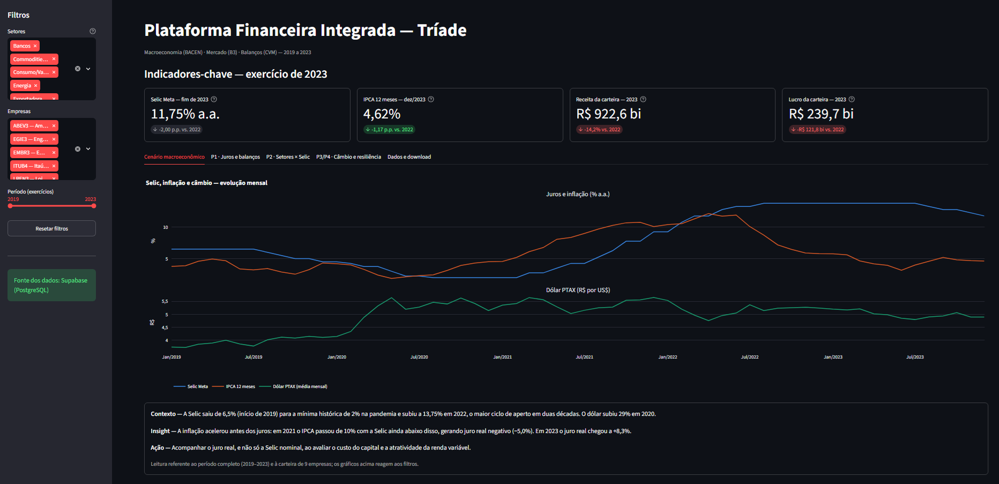

---

## Sumário

1. [Resumo](#1-resumo)
2. [Contexto e perguntas de negócio](#2-contexto-e-perguntas-de-negócio)
3. [Fontes de dados e licenças](#3-fontes-de-dados-e-licenças)
4. [Pipeline de engenharia de dados](#4-pipeline-de-engenharia-de-dados)
5. [Dicionário de dados](#5-dicionário-de-dados)
6. [Tecnologias e justificativas](#6-tecnologias-e-justificativas)
7. [Principais resultados](#7-principais-resultados)
8. [Limitações](#8-limitações)
9. [Aplicação profissional](#9-aplicação-profissional)
10. [Demonstração](#10-demonstração)
11. [Como executar localmente](#11-como-executar-localmente)
12. [Estrutura de pastas](#12-estrutura-de-pastas)
13. [Links do projeto](#13-links-do-projeto)
14. [Autoria e referências](#14-autoria-e-referências)

---

## 1. Resumo

Projeto final do curso **Visualização de Dados e Business Intelligence** (Análise de Dados — Carreira Tech, SCTEC + SENAI/SC), desenvolvido na **Linha 4 — Plataforma Financeira Integrada (Tríade: Macro + Mercado + Balanços)**.

- **3 fontes oficiais** integradas: BACEN/SGS, cotações da B3 e demonstrações financeiras da CVM;
- **Período:** 01/01/2019 a 31/12/2023 (exercícios fiscais de 2019 a 2023);
- **Carteira:** 9 companhias em 5 grupos setoriais;
- **Pipeline** em Python (pandas) e SQL, com modelagem dimensional e carga em **PostgreSQL (Supabase)**;
- **Aplicação** em Streamlit com 4 KPIs, 5 gráficos interativos em Plotly, filtros cruzados, storytelling e exportação em CSV, publicada no **Streamlit Community Cloud**.

## 2. Contexto e perguntas de negócio

Entre 2019 e 2023, a Selic Meta saiu de 6,5% para a mínima histórica de 2% na pandemia e subiu a 13,75% em 2022. No mesmo período, o dólar subiu 29% em 2020 e a inflação passou de 10% em 2021. O projeto cruza esse cenário com os balanços e as ações das empresas.

**Pergunta orientadora:** como o ciclo de juros, inflação e câmbio de 2019–2023 se relacionou com os resultados contábeis e com o retorno em bolsa de grandes empresas brasileiras?

**Perguntas de negócio oficiais da Linha 4:**

| # | Pergunta | Onde é respondida |
|---|---|---|
| P1 | Como o aperto monetário (Selic de 2% para 13,75%) impactou a despesa financeira, a alavancagem e o lucro das companhias? | Aba "P1 · Juros e balanços" |
| P2 | Como juros e inflação altos afetaram a bolsa nos setores de consumo/varejo vs. energia e bancos? | Aba "P2 · Setores × Selic" |
| P3 | As exportadoras de commodities protegeram margens e preço da ação no estresse cambial? | Aba "P3/P4 · Câmbio e resiliência" |
| P4 | Qual setor combinou melhor resiliência macro, solidez contábil e retorno em bolsa? | Aba "P3/P4 · Câmbio e resiliência" |

**Carteira analisada** (a partir do universo sugerido no escopo, com a inclusão de WEGE3 e EMBR3 aprovada pelo professor):

| Setor | Empresas |
|---|---|
| Consumo/Varejo | LREN3 (Lojas Renner), ABEV3 (Ambev) |
| Energia | PETR4 (Petrobras), EGIE3 (Engie Brasil) |
| Commodities Exportadoras | VALE3 (Vale), SUZB3 (Suzano) |
| Exportadoras Industriais | WEGE3 (WEG), EMBR3 (Embraer) |
| Bancos | ITUB4 (Itaú Unibanco) |

## 3. Fontes de dados e licenças

| Fonte | Conteúdo | Acesso | Licença / termos |
|---|---|---|---|
| **Banco Central do Brasil — SGS** | Séries 432 (Selic Meta), 433 (IPCA mensal), 13522 (IPCA 12 meses) e 1 (Dólar PTAX venda) | API pública `api.bcb.gov.br` | Dados abertos públicos, conforme os termos do Portal de Dados Abertos do BCB |
| **B3 (via Yahoo Finance)** | Cotações diárias (abertura, máxima, mínima, fechamento, fechamento ajustado e volume) | Biblioteca `yfinance`, sufixo `.SA` | Dados de mercado públicos, usados para fins educacionais e não comerciais |
| **CVM — DFP** | DRE, Balanço Patrimonial Ativo (BPA) e Passivo (BPP), consolidados | Portal de Dados Abertos da CVM (`dados.cvm.gov.br`) | Dados abertos públicos, conforme os termos do portal da CVM |

Nenhum dado pessoal é utilizado: o projeto trabalha apenas com informações públicas e agregadas de companhias abertas (em conformidade com a LGPD).

## 4. Pipeline de engenharia de dados

```
Extração              Limpeza e tipagem        Modelagem              Carga e consulta        Visualização
BACEN (API SGS)  ─┐
B3 (yfinance)    ─┼─▶ datas, tipos, escala ─▶ esquema estrela    ─▶  PostgreSQL (Supabase) ─▶ Streamlit + Plotly
CVM (DFP .zip)   ─┘   nulos, duplicados       tabela integrada        consultas SQL           (contingência: CSV)
```

| Etapa | Notebook | O que faz |
|---|---|---|
| 1. Extração BACEN | `01_etl_bacen.ipynb` | 4 séries via API, com novas tentativas e pausa entre requisições; conferência de completude (1.826 / 60 / 60 / 1.255 registros) |
| 2. Extração B3 | `02_etl_b3.ipynb` | 9 ativos × 1.241 pregões; tratamento da mudança de código da Embraer (EMBR3 → EMBJ3) |
| 3. Extração CVM | `03_etl_cvm.ipynb` | 5 arquivos anuais; filtro por **CNPJ**; apenas o exercício atual ("ÚLTIMO") e a versão mais recente de cada documento |
| 4. Limpeza e tipagem | `04_limpeza_tipagem.ipynb` | Datas com formato explícito (`%d/%m/%Y`), escala CVM de milhares para reais, padronização de colunas, volume financeiro; diagnóstico de qualidade antes/depois (0 nulos, 0 duplicados) |
| 5. Modelagem | `05_modelagem_integracao.ipynb` | `dim_empresa`, indicadores contábeis (com plano de contas próprio para o Itaú), indicadores macro e de mercado anuais e a tabela `fato_anual_integrado` (45 × 41), com JOINs protegidos por `validate` |
| 6. Carga | `06_carga_supabase.ipynb` | Carga das 9 tabelas no PostgreSQL via SQLAlchemy, com conferência de contagem CSV × banco |
| 7. Consultas SQL | `07_consultas_sql.ipynb` | Respostas às perguntas de negócio com agregações, CTE e função de janela (`RANK() OVER`) |

**Modelo de dados:** constelação de fatos (variação do esquema estrela), com a dimensão `dim_empresa` compartilhada pelas tabelas de fatos. A dimensão tempo é representada pelas colunas `data`, `mes` e `ano`.

**Resiliência:** a aplicação lê do Supabase via `st.connection("postgresql")`; se o banco estiver indisponível, carrega automaticamente os CSVs versionados em `data/processed/` (`try/except`), com `@st.cache_data(ttl=3600)`.

## 5. Dicionário de dados

O dicionário completo — com granularidade, chaves, tipo primitivo, significado financeiro e regra de cálculo de cada campo das 9 tabelas — está em **[docs/dicionario_de_dados.md](docs/dicionario_de_dados.md)**.

Principais indicadores calculados:

| Campo | Tipo | Significado financeiro | Regra de cálculo |
|---|---|---|---|
| `receita_liquida` | float64 | Receita líquida de vendas (R$) | Conta CVM 3.01 × 1.000 |
| `lucro_liquido` | float64 | Lucro líquido consolidado (R$) | Conta 3.11 (Itaú: 3.09) × 1.000 |
| `margem_ebit` | float64 | Eficiência operacional (fração) | EBIT (3.05) ÷ receita líquida |
| `roe` | float64 | Retorno sobre o patrimônio (fração) | Lucro líquido ÷ patrimônio líquido do fim do exercício |
| `liquidez_corrente` | float64 | Capacidade de pagar dívidas de curto prazo (vezes) | Ativo circulante ÷ passivo circulante |
| `divida_liquida_pl` | float64 | Alavancagem (vezes) | (Empréstimos CP + LP − caixa e aplicações) ÷ PL |
| `retorno_anual` | float64 | Retorno total da ação no ano, com proventos (fração) | Fechamento ajustado final ÷ fechamento ajustado final do ano anterior − 1 |
| `volatilidade_anual` | float64 | Risco da ação (fração) | Desvio-padrão dos retornos diários × √252 |
| `selic_media_pct` | float64 | Selic média do ano (% a.a.) | Média da série diária corrida |
| `ipca_ano_pct` | float64 | Inflação acumulada no ano (%) | [Π(1 + IPCA mensal) − 1] × 100, validado com a série oficial 13522 |
| `juro_real_pct` | float64 | Juro real ex-post (% a.a.) | Equação de Fisher: (1 + Selic) ÷ (1 + IPCA) − 1 |

## 6. Tecnologias e justificativas

| Tecnologia | Uso | Por que foi escolhida |
|---|---|---|
| **Python 3.13** | Linguagem principal | Ecossistema completo para dados, do ETL ao app |
| **pandas / numpy** | ETL e cálculos | Padrão de mercado para manipulação de dados tabulares |
| **requests** | API do BACEN e arquivos da CVM | Simples e robusto, com controle de timeout e novas tentativas |
| **yfinance** | Cotações da B3 | Acesso gratuito ao histórico com preço ajustado por proventos |
| **SQL / PostgreSQL (Supabase)** | Banco de dados na nuvem | Banco relacional gerenciado e gratuito; permite consultas analíticas e integra com o Streamlit |
| **SQLAlchemy + psycopg2** | Conexão Python ↔ PostgreSQL | Padrão do `st.connection`; driver fixado explicitamente para reprodutibilidade |
| **Plotly Express / Graph Objects** | Gráficos | Interatividade nativa (zoom, tooltips) e integração com o Streamlit |
| **Streamlit** | Aplicação web | Transforma scripts Python em apps interativos, com cache e estado de sessão |
| **Streamlit Community Cloud** | Deploy | Publicação gratuita integrada ao GitHub, com cofre de credenciais |
| **Git / GitHub (GitFlow)** | Versionamento | Branches por funcionalidade, pull requests e histórico rastreável |
| **Trello (Kanban)** | Gestão do projeto | Visualização do fluxo de tarefas e rastreabilidade card → branch → PR |

## 7. Principais resultados

**Cenário macroeconômico**
- Selic Meta: de 6,50% (início de 2019) a **2,00%** (2020–2021), pico de **13,75%** (2022) e 11,75% no fim de 2023.
- IPCA de **10,06%** em 2021, com juro real ex-post **negativo (−5,0%)**; em 2023 o juro real chegou a **+8,3%**.
- Dólar PTAX com alta de **29,2%** em 2020.

**P1 — Juros e balanços: a hipótese inicial não se confirmou**
- A despesa financeira das 8 empresas não financeiras foi **máxima em 2020 (R$ 115 bi)**, com a Selic no piso, e menor em 2022–2023 (R$ 39–52 bi), com a Selic acima de 12%.
- A alavancagem média (Dívida Líquida/PL) caiu de **1,46 (2020) para 0,42 (2023)**.
- Explicação provável: dívidas em dólar pressionadas pelo câmbio de 2020 e desalavancagem das empresas antes do aperto monetário.

**P2 — Setores × Selic**
- Consumo/Varejo teve retorno médio **negativo de 2020 a 2023**.
- Em 2023, com a Selic média em 13,3%, **Energia (+62,5%)** e **Bancos (+42,3%)** lideraram.

**P3 — Exportadoras no estresse cambial (2020)**
- VALE3 **+70,9%** e SUZB3 **+47,5%** em bolsa; a Suzano manteve margem EBIT de 27,7%, mas registrou prejuízo contábil (ROE −146%) pela reavaliação da dívida em dólar — efeito contábil, sem impacto direto no caixa operacional.
- Exceção: EMBR3 (−55,1%), com a aviação paralisada pela pandemia.

**P4 — Setor mais resiliente: Energia**
- Maior retorno acumulado 2019–2023 (**+190%**), maior ROE médio (**28,3%**), maior margem EBIT média (**41,1%**) e menor volatilidade média.
- A WEG, com margem EBIT moderada (~17%), teve o **maior retorno da carteira (~+340%)**: o mercado precifica crescimento, não apenas margem.

**Indicadores-chave de 2023 (carteira completa):** Selic 11,75% a.a. · IPCA 4,62% · Receita R$ 922,6 bi (−14,2%) · Lucro R$ 239,7 bi.

## 8. Limitações

- **Associação estatística não implica causalidade:** as relações apresentadas são descritivas.
- **Amostra pequena por setor** (1 a 2 empresas): as conclusões valem para estas companhias, não para o setor inteiro.
- **Médias simples** entre empresas; ROE calculado sobre o PL do fim do exercício (sem PL de 2018 para a média).
- **Itaú (ITUB4):** instituição financeira com plano de contas próprio; margens, liquidez e dívida líquida não são aplicáveis.
- **Retorno de 2019** calculado a partir do 1º pregão do ano (sem dados de 2018).
- O retorno do **ITUB4 em 2021** pode estar subestimado pela cisão da participação na XP Inc., possivelmente não refletida no preço ajustado da fonte.
- **Embraer:** código alterado de EMBR3 para EMBJ3 em 2025; o projeto mantém o código histórico e busca os dados pelo código atual.
- **Volume financeiro estimado** (fechamento × quantidade), não a soma exata dos negócios.
- **Calendários diferentes:** a B3 tem 1.241 pregões no período e a PTAX, 1.255 dias úteis.
- O ROE negativo da VALE3 em 2019 reflete o rompimento da barragem de Brumadinho, evento não macroeconômico.

## 9. Aplicação profissional

- **Gestores e analistas financeiros:** avaliar a exposição de empresas e setores a juros e câmbio, separando o risco da Selic do risco cambial da dívida.
- **Investidores:** comparar solidez contábil e retorno em bolsa entre setores ao longo de um ciclo monetário completo.
- **Educação financeira:** material visual para ensinar conceitos como juro real, Base 100, ROE e volatilidade com dados reais.
- **Arquitetura replicável:** o mesmo pipeline (APIs públicas → ETL → banco na nuvem → app) pode ser reutilizado para outras carteiras ou períodos alterando poucos parâmetros.

## 10. Demonstração

**Indicadores-chave e abas temáticas**


**Gráfico 1 — Selic, inflação e câmbio (painéis alinhados)**
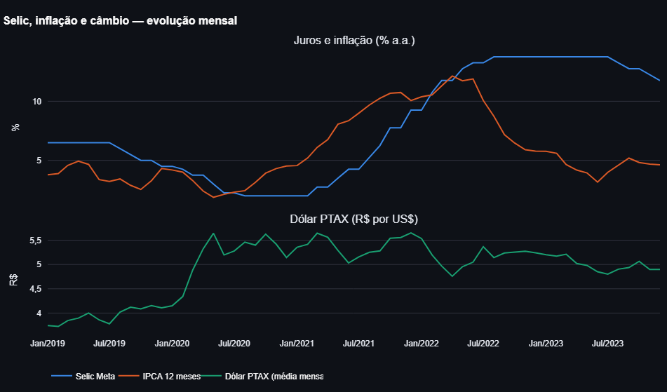

**Gráfico 2 — Desempenho das ações em Base 100**
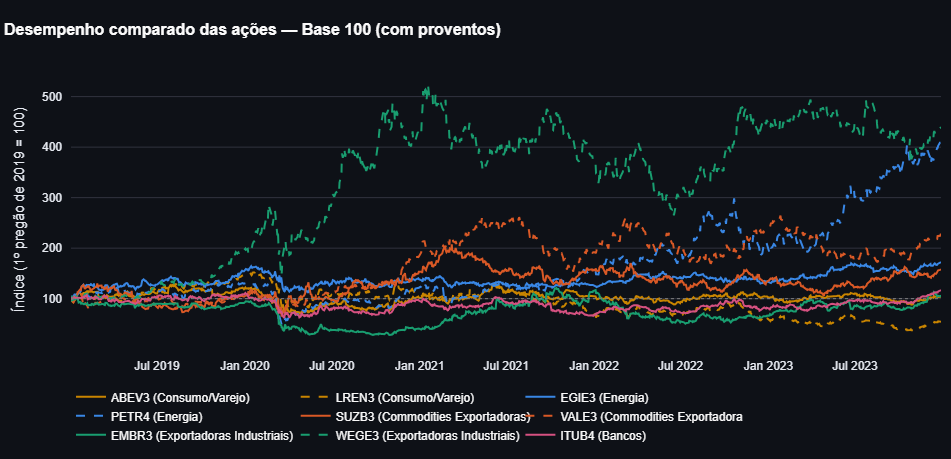

**Gráfico 3 — Lucro líquido e ROE por empresa**
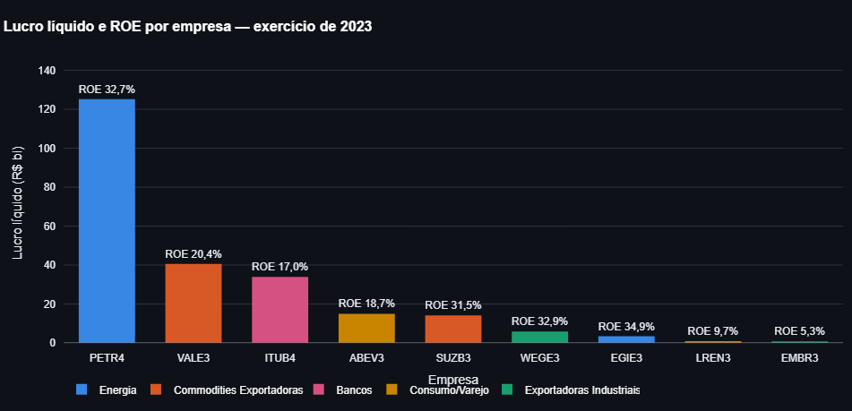

**Gráfico 4 — Retorno setorial × Selic média**
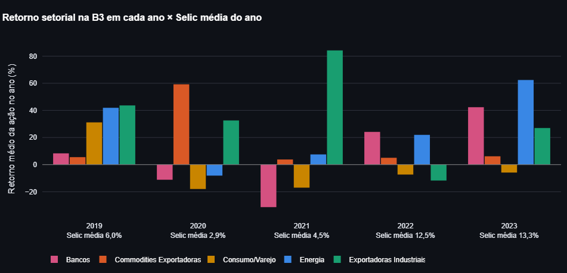

**Gráfico 5 — Margem EBIT × retorno acumulado**
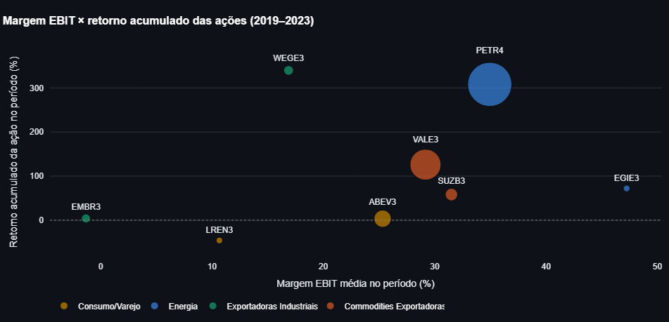

**Filtros cruzados na barra lateral**
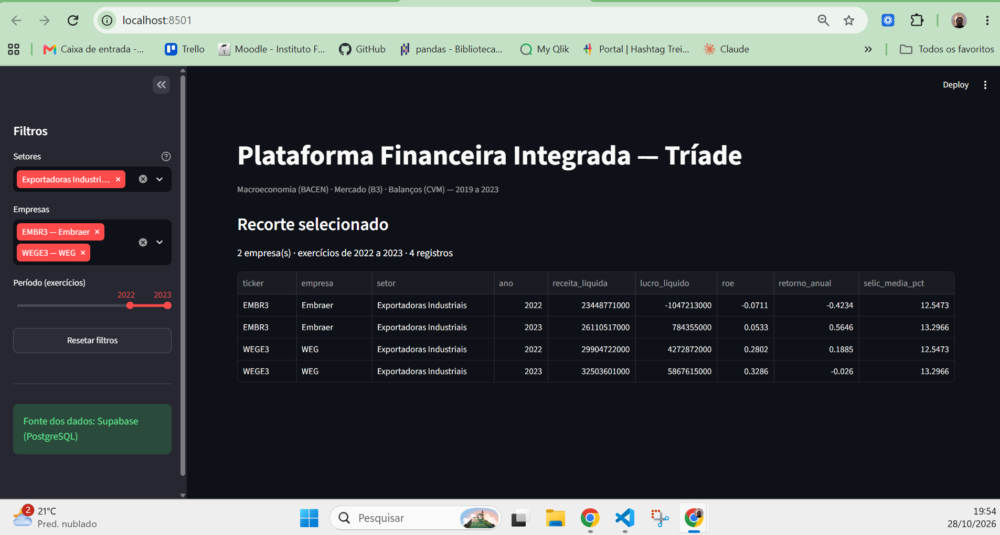

**Tabela formatada, download em CSV e limitações**
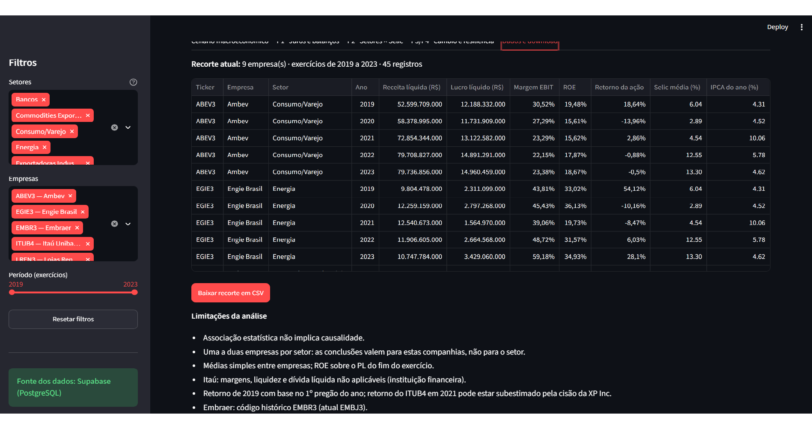

**Aplicação publicada no Streamlit Community Cloud**
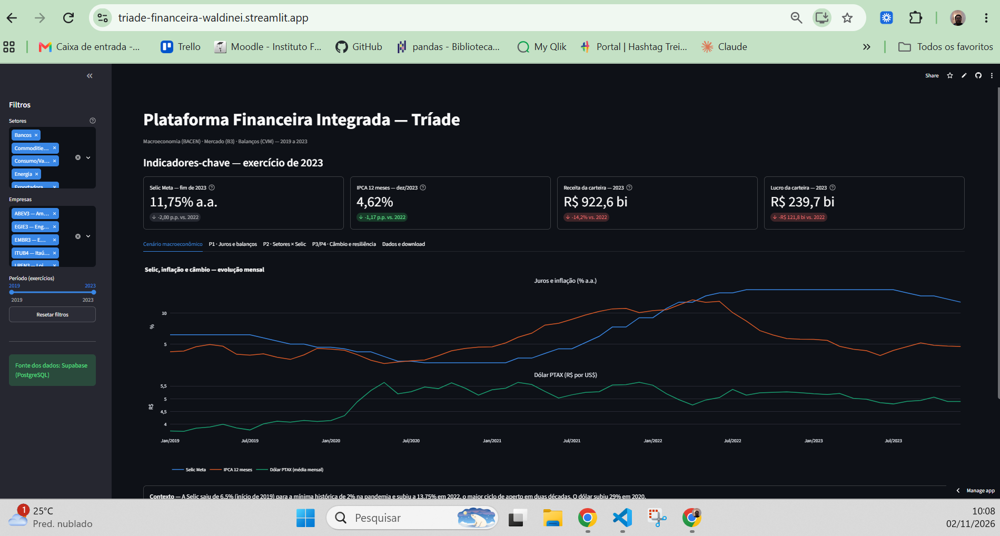

**Contingência em ação:** com o banco indisponível, o app carrega automaticamente os CSVs locais.
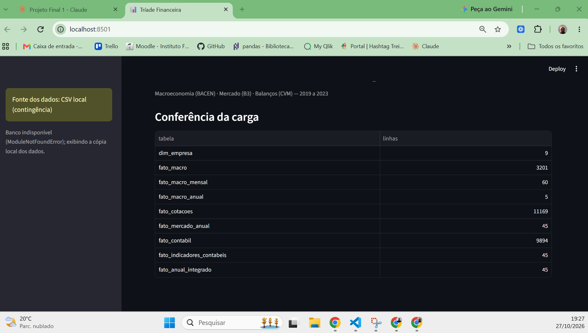

> **Nota de design:** o gráfico macro usa painéis alinhados em vez de eixo duplo, porque escalas independentes podem sugerir relações inexistentes entre as séries. As cores são fixas por setor (a cor acompanha a entidade, não a posição) e a paleta foi escolhida para boa distinção também por pessoas com daltonismo.

## 11. Como executar localmente

Pré-requisitos: **Python 3.13** e **Git**.

```bash
# 1. Clonar o repositório
git clone https://github.com/waldineilameira-lab/Projeto_Triade_Financeira_Waldinei.git
cd Projeto_Triade_Financeira_Waldinei

# 2. Criar e ativar o ambiente virtual
python -m venv .venv
.venv\Scripts\activate          # Windows
# source .venv/bin/activate     # Linux / macOS

# 3. Instalar as dependências
pip install -r requirements.txt

# 4. Rodar a aplicação
streamlit run app.py
```

**Banco de dados (opcional):** copie `.streamlit/secrets.toml.example` para `.streamlit/secrets.toml` e preencha com as credenciais de um projeto Supabase (conexão *Session pooler*). Sem esse arquivo, a aplicação funciona normalmente com os CSVs de `data/processed/`.

**Reproduzir o pipeline:** execute os notebooks de `notebooks/` na ordem numérica (01 a 07). Para rodar notebooks, instale também o `ipykernel`.

## 12. Estrutura de pastas

```
Projeto_Triade_Financeira_Waldinei/
├── .streamlit/
│   ├── config.toml               # Tema da aplicação
│   └── secrets.toml.example      # Modelo de credenciais (o secrets.toml real não é versionado)
├── data/
│   ├── raw/                      # Dados brutos (não versionados; gerados pelos notebooks 01–03)
│   └── processed/                # Tabelas tratadas (versionadas; contingência do app)
├── docs/
│   ├── dicionario_de_dados.md    # Dicionário de dados completo
│   └── img/                      # Capturas de tela do app, do Trello e do GitFlow
├── notebooks/
│   ├── 01_etl_bacen.ipynb
│   ├── 02_etl_b3.ipynb
│   ├── 03_etl_cvm.ipynb
│   ├── 04_limpeza_tipagem.ipynb
│   ├── 05_modelagem_integracao.ipynb
│   ├── 06_carga_supabase.ipynb
│   └── 07_consultas_sql.ipynb
├── src/
│   ├── dados.py                  # Conexão Supabase, contingência em CSV e cache
│   ├── filtros.py                # Barra lateral, session_state e reset
│   ├── kpis.py                   # KPIs com st.metric e deltas
│   ├── graficos.py               # 5 gráficos em Plotly
│   └── narrativa.py              # Storytelling (Contexto → Insight → Ação)
├── app.py                        # Aplicação Streamlit
├── requirements.txt              # Dependências com versões fixadas
├── .gitignore
└── README.md
```

## 13. Links do projeto

- **Aplicação:** https://triade-financeira-waldinei.streamlit.app
- **Vídeo de apresentação:** https://youtu.be/g8P9FiaQA8Y
- **Quadro Trello:** https://trello.com/b/8XrmtPm5/projeto-triade-financeira-waldinei

**Gestão ágil no Trello** — cards com responsável e especificação de implementação, um card por vez em andamento:
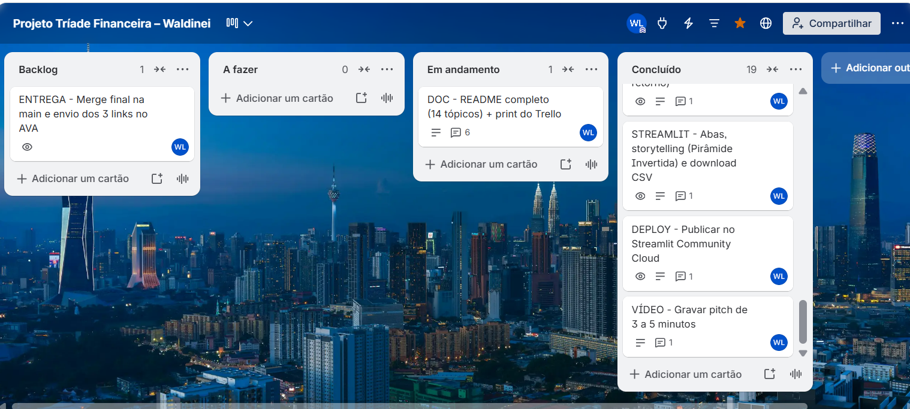

**Versionamento com GitFlow** — `main` (estável), `develop` (integração) e branches `feature/*` / `fix/*` por tarefa, integradas via pull requests:
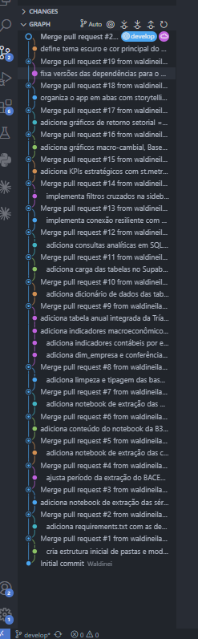

## 14. Autoria e referências

**Autor:** Waldinei Lameira — professor de Matemática em transição para Análise de Dados e Business Intelligence.
- GitHub: [waldineilameira-lab](https://github.com/waldineilameira-lab)
- LinkedIn: https://www.linkedin.com/in/waldineilameira/

**Curso:** Visualização de Dados e Business Intelligence — Análise de Dados, Carreira Tech (SCTEC + SENAI/SC). Professor: Savio Ricardo Garcia.

**Referências e documentações consultadas:**
- Banco Central do Brasil — Sistema Gerenciador de Séries Temporais (SGS) e Portal de Dados Abertos.
- Comissão de Valores Mobiliários — Portal de Dados Abertos (Demonstrações Financeiras Padronizadas).
- Documentações oficiais: [Streamlit](https://docs.streamlit.io), [Plotly](https://plotly.com/python/), [pandas](https://pandas.pydata.org/docs/), [SQLAlchemy](https://docs.sqlalchemy.org), [Supabase](https://supabase.com/docs) e [yfinance](https://github.com/ranaroussi/yfinance).
- KIMBALL, R.; ROSS, M. *The Data Warehouse Toolkit*. Wiley — modelagem dimensional.
- KNAFLIC, C. N. *Storytelling com Dados*. Alta Books — Pirâmide Invertida e comunicação visual.
- NIELSEN, J. *10 Usability Heuristics for User Interface Design*. Nielsen Norman Group.
- Apoio de assistente de IA (Claude, Anthropic) para orientação passo a passo durante o desenvolvimento; código, análises e decisões revisados e validados pelo autor.
